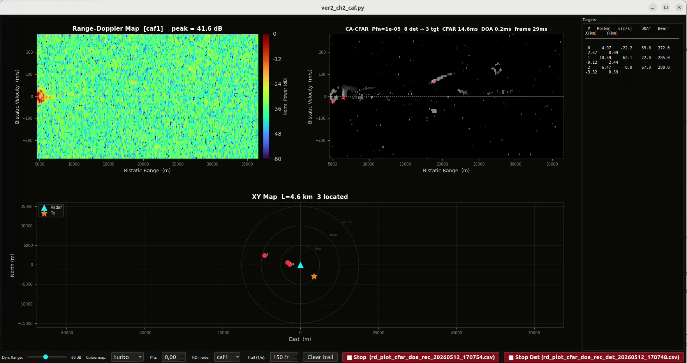
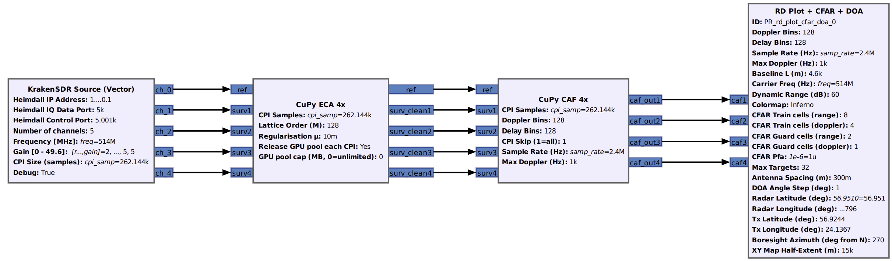
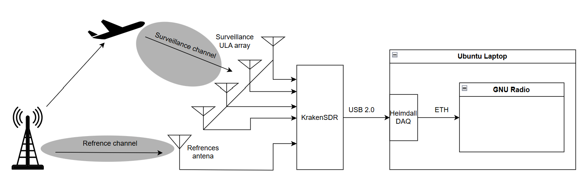
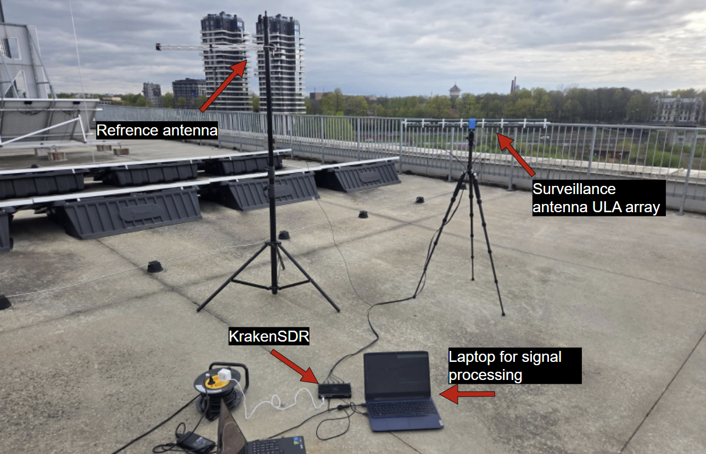

# gr-PR — Passive Radar GNU Radio OOT Modules 

>GNU Radio OOT modules implementing a multichannel DVB-T passive radar with DoA using KrakenSDR made as a part of a bachelor's
[thesis](PR_bak_PUB_fin.pdf)

---

## Overview

**gr-PR** is a collection of GNU Radio Python blocks for building a
**Passive radar** receiver. Passive radar detects targets 
by using existing broadcasts as Illuminators of Opportunity to illuminate targets (**IoO**) — currently tested against **DVB-T**

This repository was made as part of a bachelor's thesis
"**GPU-accelerated passive DVB-T radar system with direction-of-arrival estimation in GNU Radio**".
It consists of different implementations of these algorithms in different ways (combinations using NumPy and CuPy)
- ECA (Extensive Cancellation Algorithm)
- CAF (Cross-Ambiguity function)
- CFAR (Constant False Alarm Rate)
- DoA (Direction of Arrival)
<!-- TODO: add a link to the thesis here -->

---

## Signal-processing pipeline

## Hardware setup

## Testing setup

## Known errors - bottlenecks
 - The frame rate is quite poor — only 1 in 5 CPI vectors were processed (discarding the rest) in current testing; the main culprit is thought to be the rd_plot+cfar+doa visual processing thread
 - The ECA blocks still leave some residuals in 0 doppler
   

